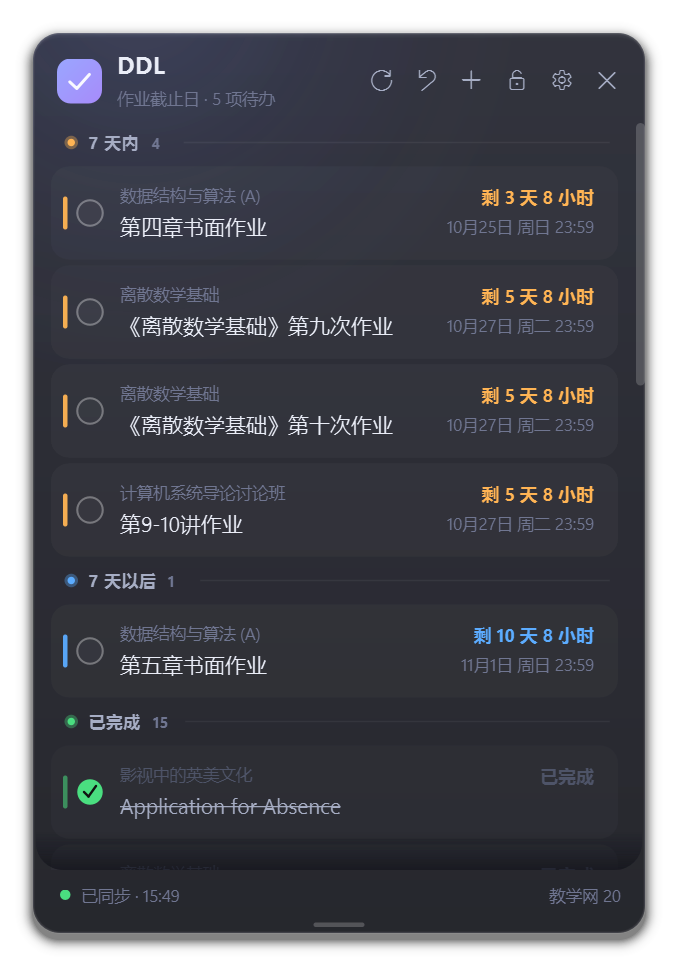
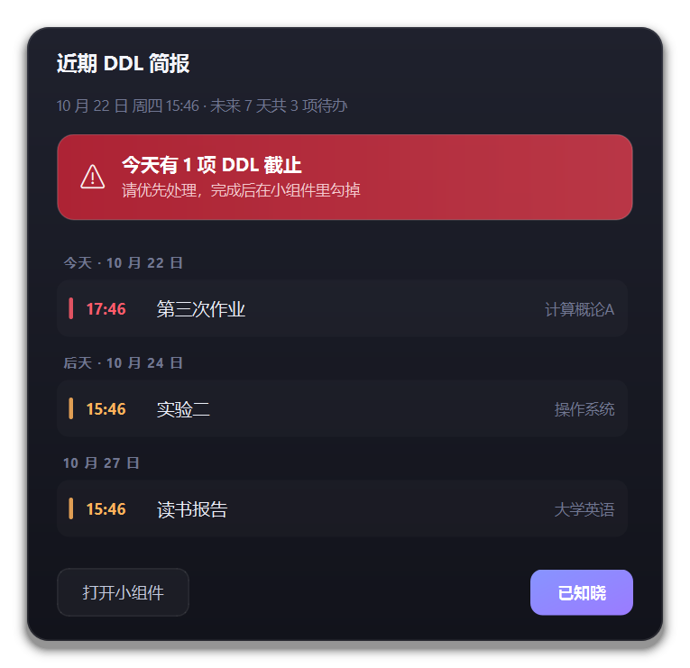
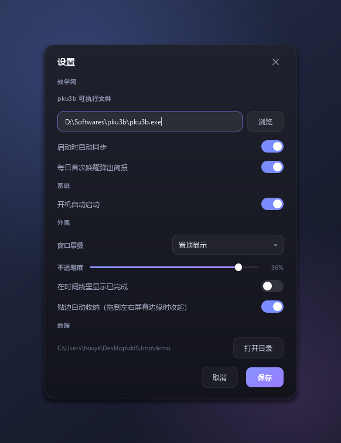
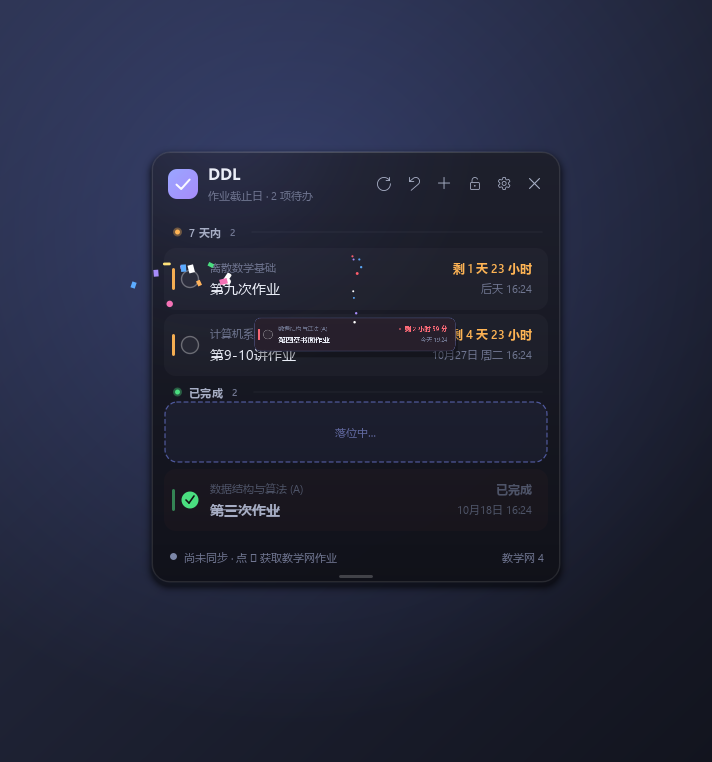
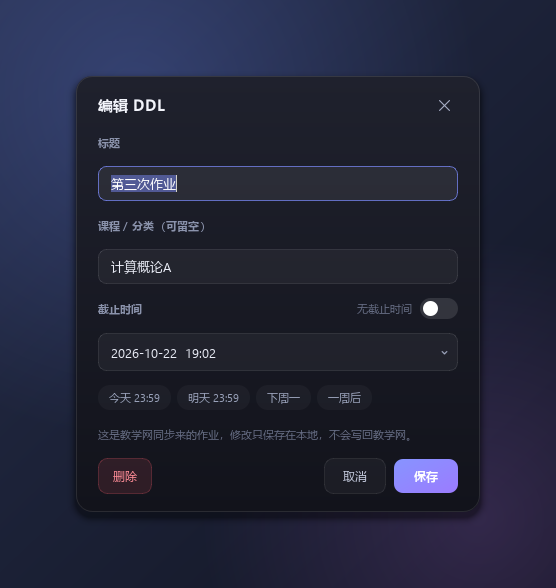
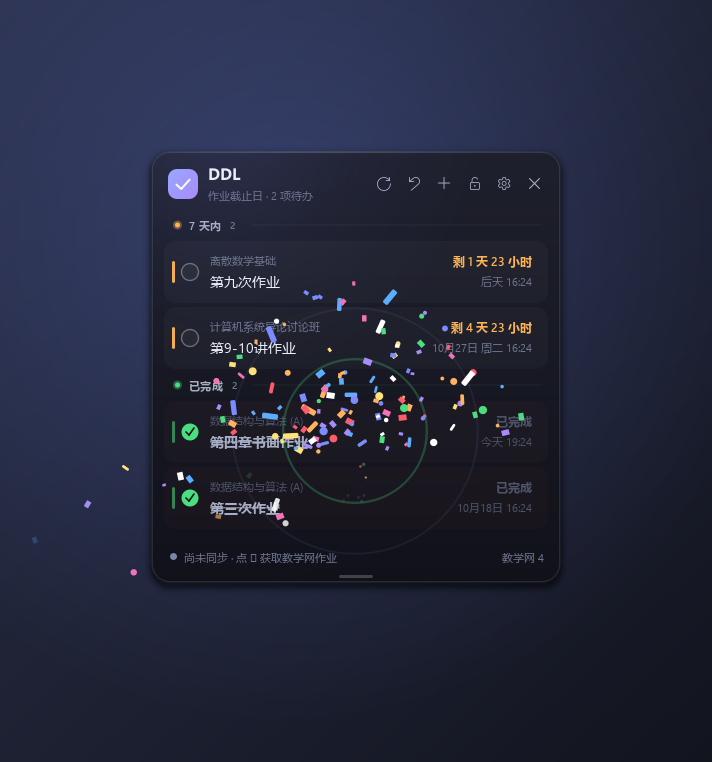

# DDL 桌面小组件

> 把北大教学网的作业截止日做成一块贴在桌面上的玻璃看板。数据来自 [pku3b](https://github.com/sshwy/pku3b)，
> 也支持手动添加自己的截止事项。




---

## 特性

**时间线看板**
- 无边框、半透明、圆角、外阴影，跟随系统 DPI
- 按紧急度自动分组：已逾期 / 24 小时内 / 7 天内 / 7 天以后 / 未定截止 / 已完成
- 每条显示实时倒计时（`剩 4 小时 20 分`）+ 具体截止时间，紧急项带呼吸点

**完成任务的特效**
- 勾选时列表做 FLIP 重排（其余行平滑移动，不跳帧），被勾的那行**浮起成卡片，沿弧线飞进已完成区**，落地炸开礼花
- 同步时发现教学网上有新提交的作业，同样有 ✓ 卡片从 ⟳ 按钮飞出

**桌面融合**
- 拖到屏幕左 / 右边缘自动吸附；鼠标离开 0.3 秒后**整块移出屏幕**，贴边即可滑出
- 三种层级：置顶 / 普通 / 贴桌面层
- 高度可拖拽调整，双击底部横条恢复自适应
- 记住位置；拖到屏幕外会被拉回来

**提醒**
- 每日首次启动 / 跨天 / 休眠唤醒时，自动同步并弹出「近期 DDL 简报」
- 有今天截止的作业时：红色横幅 + Windows 原生 Toast，**必须点「已知晓」才能关闭**

**数据**
- 本地 SQLite，自动去重与增量更新
- 同步**永不覆盖**你手动标记的完成状态、手动添加的条目、你改过的标题
- 一键把教学网上仍未提交的作业全部恢复为待办

---

## 快速开始

### 依赖

| 依赖 | 说明 |
|---|---|
| Windows 10 / 11 | 用了注册表自启、系统托盘、DWM 透明窗口 |
| Python 3.10+ | 需要 PySide6 |
| [pku3b](https://github.com/sshwy/pku3b) | 爬取教学网，Rust 编译的单文件 exe |
| PySide6 | `pip install PySide6` |

### 1. 装 pku3b 并登录一次

```powershell
pku3b init
```

凭据写在 `%APPDATA%\sshwy\pku3b\config\cfg.toml`，本程序不读取也不存储它，只是调用 exe。

### 2. 拿代码、装依赖

```powershell
git clone https://github.com/Schi2oid/ddl-widget.git
cd ddl-widget
pip install PySide6
```

### 3. 启动

双击 **`启动小组件.vbs`**（无控制台窗口）。

它默认用 `D:\Softwares\anaconda\pythonw.exe`，找不到就退回 PATH 上的 `pythonw.exe`。
如果你的 Python 装在别处，改一下这个文件里的 `pythonw` 变量就行。

也可以直接 `python run.pyw` 启动（会带控制台，适合调试）。

首次启动会自动同步一次；右上角 **⟳** 随时手动同步，**＋** 添加手动 DDL。

> 关掉窗口 = 收进系统托盘，程序仍在后台（这样每日提醒才有意义）。彻底退出请用托盘菜单。

---

## 界面操作

| 操作 | 效果 |
|---|---|
| 点左侧圆圈 | 标记完成 / 取消完成（带动画） |
| 点一行 | 编辑（改标题、课程、截止时间；也可删除） |
| 拖标题区 | 移动窗口，自动记忆坐标 |
| 拖底部小横条 | 调整窗口高度；双击恢复自适应 |
| 拖到屏幕左/右边缘 | 自动收纳；鼠标贴边滑出 |
| 右键 | 同步 / 恢复为待办 / 锁定 / 置顶 / 贴桌面层 / 显示已完成 / 高度自适应 / 设置 |
| 标题栏 ⟳ | 立即同步教学网 |
| 标题栏 ↰ | 把教学网上未提交的作业全部恢复为待办 |
| 标题栏 ＋ | 添加手动 DDL |
| 标题栏 🔒 | 锁定位置（只锁拖动，不锁调高度） |
| 标题栏 ✕ | 隐藏到托盘 |

| 简报 | 设置 |
|---|---|
|  |  |

| 完成特效·飞行 | 编辑器 |
|---|---|
|  |  |

| 完成特效·落地礼花 | 悬停提示（自绘，非系统 tooltip） |
|---|---|
|  |  |

---

## 工作原理

### 同步：pku3b 没有 JSON

`pku3b a -f ls -a` 只输出人读文本（带 ANSI 颜色）：

```text
计算概论A > 第三次作业 (in 3d 4h 20m 30s) f4f30444c7485d49
```

所以 `sync.py` 的做法是：

1. 剥掉 ANSI 转义码；
2. 用 `课程名 > 标题 (状态) 短ID` 的正则解析每一行；
3. 倒计时只有相对值，**绝对截止时间用「同步完成时刻 + 倒计时」重建**（秒级误差，按分钟取整）；
4. `已完成: …` / `无截止时间` / `due` / 中文原始日期都能识别。

### 合并：用户的改动永远优先

每条 DDL 有 `source`（`pku3b` / `manual`）和几个状态位，同步时：

| 情况 | 行为 |
|---|---|
| 手动添加的条目 | 同步完全不碰 |
| 你手动勾过完成状态 | `status_locked=1`，同步不再回写 |
| 你改过标题 / 课程 | 同步不再覆盖这两个字段（截止时间仍跟随教学网） |
| 你删除过教学网条目 | 留墓碑，不会被下次同步复活 |
| 教学网上消失了 | 标记 `stale` 隐藏，不硬删，保留你的历史 |

已完成区按「完成时间倒序」排，所以刚勾掉的会出现在最上面。

---

## 数据与配置

| 内容 | 位置 |
|---|---|
| 数据库 / 设置 / 日志 | `%APPDATA%\DDLWidget\` （`ddl.db`、`settings.json`、`app.log`） |
| pku3b 配置 | `%APPDATA%\sshwy\pku3b\config\cfg.toml` |
| pku3b 缓存 | `%LOCALAPPDATA%\sshwy\pku3b\cache`（可能很大，用 `pku3b cache clean` 清） |

数据目录不可写时会自动降级到程序目录下的 `data/`。
想从头开始就删掉 `%APPDATA%\DDLWidget\`；想重放每日简报就删掉 `ddl.db` 里 `meta` 表的 `last_daily_popup_date`。

主要设置项（`settings.json`）：`pku3b_path`、`always_on_top`、`desktop_layer`、`opacity`、
`edge_dock_enabled`、`list_height`、`show_completed`、`daily_briefing`、`sync_on_start`。

---

## 常见问题

**启动报 `DLL load failed while importing QtCore`**
第三方软件（典型是 MikTeX）自带的 `Qt6Core.dll` 会抢在 PySide6 前面被加载。
`run.pyw` 启动时会把这类目录从 PATH 里摘掉，正常不会出现；如果仍有问题，
检查 PATH 里是否有其它 Qt 安装。

**贴边收起后找不到了？**
鼠标贴到屏幕边缘、约 5px 宽的感应带里（在窗口原来的上下范围内）就会滑出来。
也可以点托盘图标 → 显示小组件。

**Win + D / 触控板回桌面之后贴边没反应？**
已处理：唤起时会主动解除系统最小化。若仍出现，先看托盘图标还在不在 —— 不在说明进程被结束了。

**同步失败怎么办？**
日志在 `%APPDATA%\DDLWidget\app.log`。常见原因是 pku3b 登录态过期，跑一次 `pku3b init` 即可。
在程序里点 ⟳ 会带上 `-f` 强制刷新，绕过 pku3b 的 1 小时缓存。

**为什么只同步当前学期？**
`a ls -a` 只取当前学期。历史学期里的未完成作业意义不大，所以没纳入。

**已经过期的作业没有具体时间？**
pku3b 对逾期项只打印 `due`，不给绝对时间。第一次见到就已逾期的会显示「已逾期」；
之前同步过的会保留存下来的时间。

---

## 开发

```powershell
python tests\test_core.py          # 解析 / 合并 / 排序（32 项）
python tests\test_e2e.py           # 真实子进程同步、失败路径、自启注册表（19 项）
python dev\repro_edge.py           # 贴边收纳 / 感应带 / 最小化恢复
python dev\test_flip.py            # 完成时的 FLIP 重排
python dev\shot.py all             # 离屏渲染界面到 dev/shots/
python dev\live_shot.py            # 真实平台截图（会短暂显示窗口）
```

```text
run.pyw                 入口（先修 Qt DLL 搜索路径，再启动）
启动小组件.vbs           无控制台启动器
ddlwidget/
  app.py                控制器：单实例、同步线程、每日调度、托盘接线
  main_window.py        无边框玻璃卡片主窗、贴边收纳、FLIP 重排
  widgets.py            自绘控件：图标按钮、DDL 行、分组标题、开关
  dialogs.py            添加/编辑、设置
  briefing.py           每日简报面板
  fx.py                 完成特效：飞行卡片 + 礼花粒子层
  tips.py               自绘悬停提示（替代会冒出黑框的系统 tooltip）
  tray.py               托盘
  theme.py              配色、字体、QSS
  models.py             DDL 模型、紧急度、倒计时文案
  db.py                 SQLite 持久层与合并规则
  sync.py               pku3b 调用、输出解析、入库
  winutil.py            DLL 路径修复、自启注册表、窗口层级、单实例
  paths.py / settings.py / icons.py
docs/screenshots/       README 用的截图
dev/                    开发与自检脚本
tests/                  自检脚本（无需 pytest）
```

---

## 已知限制

- 只同步当前学期
- 首次见到就已逾期的作业拿不到绝对时间
- 每日简报只覆盖未来 7 天
- 仅支持 Windows（注册表自启、原生 Toast、DWM 透明窗口）

## 致谢

- [pku3b](https://github.com/sshwy/pku3b) —— 没有它就没有这个项目
- [Qt for Python (PySide6)](https://doc.qt.io/qtforpython/)

## License

暂未指定。如果你想用它，开个 issue 或者自己 fork 就好。
